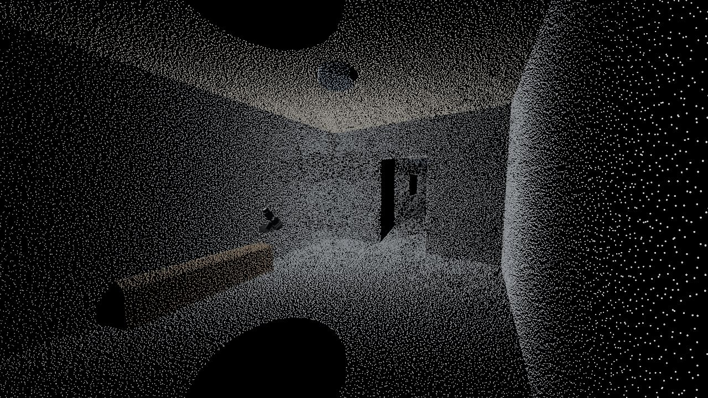
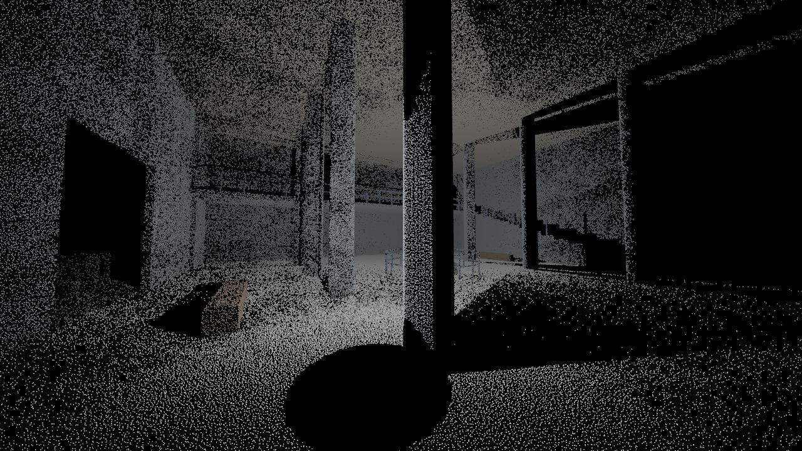
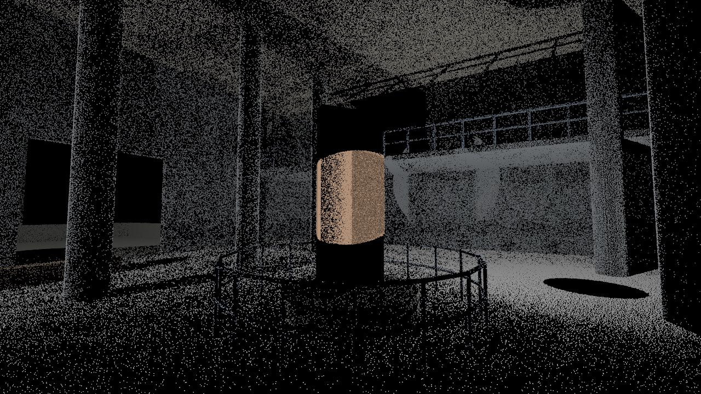
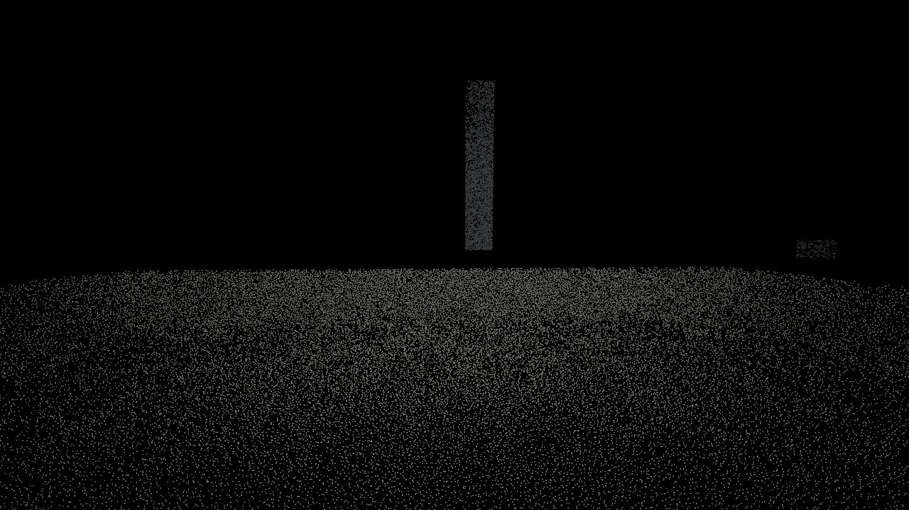

# lidar-game

A VR exploration game for the Steam Frame (working name). You are alone in the dark with a handheld lidar
scanner. Every ray that hits something leaves a dot that stays, and the world exists only as the point cloud
you build. Tense, empty, liminal; no jump scares.

Built on WebXR + three.js + Rapier, run from Chrome or Edge on a PC and streamed to the headset through
SteamVR. Levels are authored in Blender.

**Status (2026-10-20): first milestone (V1, technical viability) done in the emulator; not yet tried on the
Frame.** Scanning, a persistent cloud of up to 4 M dots, material and live distance colouring, fading dots on
moving things, saving between visits, analogue walking with collision and stairs, a Blender level pipeline,
and 25 self-test checks. Numbers and reasoning: [DECISIONS.md](DECISIONS.md). Plan and next steps:
[PLAN.md](PLAN.md).

| | |
|---|---|
|  |  |
| The vestibule after one sweep: the bench (wood reads warmer), the doorway, the lamp above. | The hall: columns, the mezzanine railing, the stairs. Black is what hasn't been scanned. |
|  |  |
| The monolith turns; its dots (warm) fade within 2.6 s, leaving a trail of where it was. | From the terrace: the expanse, a tower 43 m away, a standing stone. |

(Snapshots at 1280×720 from the emulator. In the headset the dots are smaller relative to the view.)

## Run it on the Steam Frame (PC streaming)

1. Start SteamVR with the Frame connected.
2. In this folder: `npm install` (once), then `npm run dev`.
3. Open http://localhost:5180 in Chrome or Edge on the PC and press **Enter VR**.

The standalone path (a WebXR browser on the Frame itself) is untested; `npm run dev:lan` serves HTTPS on the
LAN for it, as in vr-test.

### First run on the Frame: what to check

This milestone is about whether the technology holds up, so the useful reports are about how it looks and
feels through the stream:

1. **Dots, standing still:** do near and far dots look crisp, or smeared and blocky? Do far dots vanish or
   crawl? Try the wrist menu's **Min dot** (1.5 / 2.5 / 3.5 px) and say which reads best.
2. **Dots, turning your head:** smearing, wobble or "crawling noise" while you turn, slowly and quickly.
3. **Brightness as depth:** does walking toward a wall (it brightens) read as distance? Is anything too dim?
4. **Palettes:** Ash (default), Tinted, Mono. Does the faint material tint come through the stream at all?
5. **Moving things:** the monolith in the hall and the pendulum through the corridor window. Does the fading
   trail read as motion?
6. **Walking:** stick speed (1.6 m/s at full), stairs up and down, bumping into unscanned walls (also by
   walking in your room), leaning over the mezzanine railing. Any discomfort in the dark?
7. **Scanning feel:** the cone narrowing as you squeeze, the hum and hiss, the haptics. The scanner now sends a
   fixed number of rays per second, so a light pull (wide) gives sparse dots and a squeeze (narrow) dense ones.
   Try the menu's Scan rate (5k / 10k / 20k per second): which makes scanning feel like effort without being
   tedious?
8. **Persistence:** scan a bit, exit, reload the page, re-enter: your scan should be back.
9. **Numbers, if you can:** the wrist menu's **Info** page (fps, GPU ms, eye resolution, refresh rates) and
   SteamVR's frame timing and stream settings (codec, bitrate, foveated streaming on or off).

## Controls

- **Trigger** (scanner hand, right by default): scan. Squeeze harder to narrow the cone from wide to a spot.
- **Left stick:** walk (analogue). **Right stick:** turn (snap 45° by default).
- **Look at your free palm** for the menu. Point the scanner at it and pull the trigger (it won't scan while
  you point at the menu), or poke it.
  - **Scan:** dot count and memory, save state, *Save now*, *Back to start*, *Clear scan* (press twice).
  - **Settings:** turning, vignette, scanner hand, palette, occlusion (x-ray off/on), minimum dot size, scan
    rate (5k / 10k / 20k rays per second; the wide cone spreads the same rays more thinly).
  - **Info:** fps, GPU and CPU ms, draw calls, scan rate, eye resolution, controller profiles.

## Levels

Levels are `.blend` files in `levels/`, exported to `public/levels/*.glb` with `npm run levels`. Material
names choose the dots' colour; `entity…` materials make fading dots; animations made in Blender play in the
game. Conventions: [levels/README.md](levels/README.md). Open another level with `?level=<name>`.

## Testing without a headset

| URL | What it does |
|---|---|
| `?emulate` | An emulated headset (IWER) shaped like the Frame. Any desktop browser can enter "VR". |
| `?emulate&devui` | Plus IWER's on-screen controls (mouse and keyboard). |
| `?emulate&autostart` | Enter the emulated session at once; `window.__driver` moves the head and hands from the console. |
| `?emulate&selftest` | The 25 scripted checks (`?selftest=scan-wall,stairs` for some). Results in `window.__selftest` and `[selftest] {…}` console lines. Uses its own save slot. |

Other flags: `?level=<name>`, `?slot=<name>` (save slot, default `main`), `?fresh` (start with an empty scan),
`?seed=<n>` (repeatable scans), `?quality=low|high`.

From the console (`window.__vr`): `state()`, `events()`, `snapshot(name, {from, to, fov})` (dev server only:
writes `.snapshots/<name>.png`), `measure(opts)`, `bench.fill(n)` (fill the cloud with n dots),
`bench.eyes(opts)` (GPU time for two 2160² eyes).

Benchmarks outside the game: `bench/points-bench.html` (raw WebGL dots; open it through the dev server) and
`npm run bench:rays` (Rapier ray cost).

**Codec simulator** (how dots survive the headset's video stream, without a headset): `?capture=<name>&motion=still|sway|yaw30|yaw120|walk|scan`
on the dev server renders 90 frames of one 2160² eye into `.captures/<name>/` (`&minpx= &palette= &cell=` pick
the style), then `python tools/codec/codec.py all <name>` encodes them with NVENC at 25–200 Mbps and measures
dot survival, shimmer and SSIM, with zoomed crops. Results and the recommended style: [docs/codec-report.md](docs/codec-report.md).

## Scripts

| Script | |
|---|---|
| `npm run dev` | Dev server on http://localhost:5180 |
| `npm run dev:lan` | HTTPS on the LAN (for a headset browser) |
| `npm run build` | Type-check and build to `dist/` |
| `npm run preview` | Serve the build on http://localhost:4180 |
| `npm run levels` | Export `levels/*.blend` to `public/levels/*.glb` (needs Blender) |
| `npm run bench:rays` | Rapier ray-cast benchmark |

## Layout

```
src/
  main.ts, app.ts, config.ts   boot, frame loop, tunables and URL flags
  core/       renderer, XR session, settings, stats + GPU timer, events, math
  input/      XR input (poses, buttons, sticks, haptics)
  level/      Blender level loading (colliders, depth pass, animation), materials and palettes
  physics/    Rapier world: level colliders, moving parts, the player's body, scanner rays
  scan/       the scanner
  cloud/      dot shader, point store (chunks, dedup, blocks), fading entity dots, saving
  play/       walking, turning, comfort
  hands/      hand model
  audio/      Web Audio engine and synthesized sounds
  ui/         wrist menu
  dev/        emulator, driver, self-test, probe, snapshots, benchmarks
levels/       .blend sources (and the authoring guide)
public/levels/  exported .glb files the game loads
tools/        Blender scripts, level export, contact sheet, codec simulator (tools/codec/)
bench/        standalone benchmarks
```
