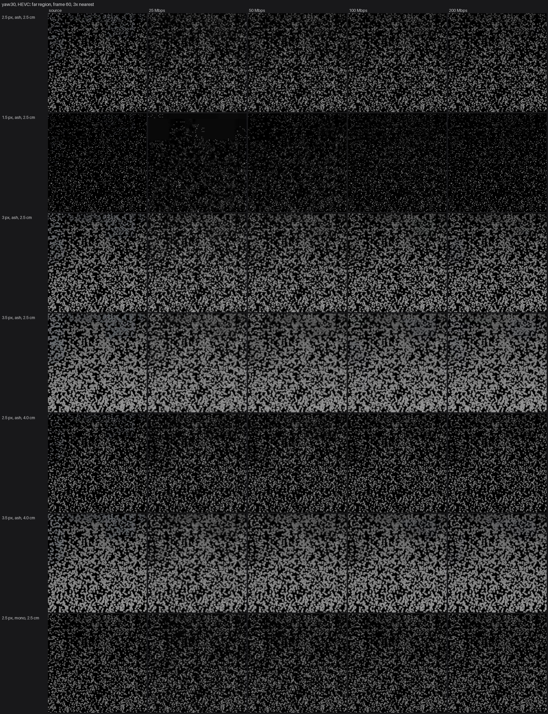
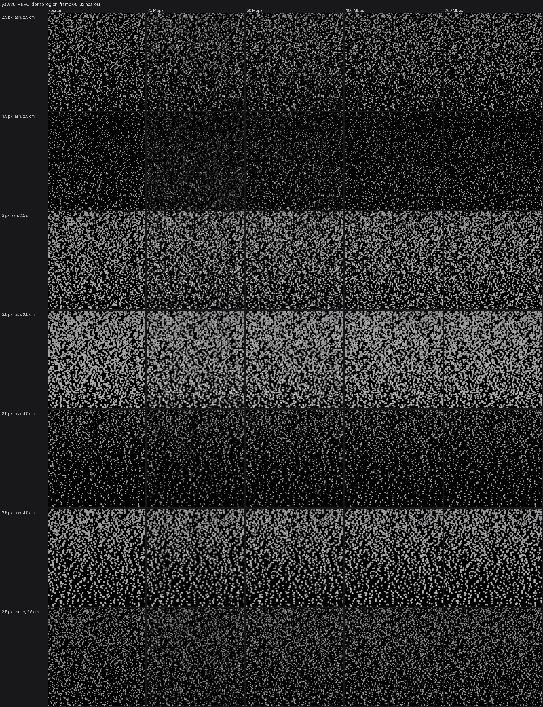
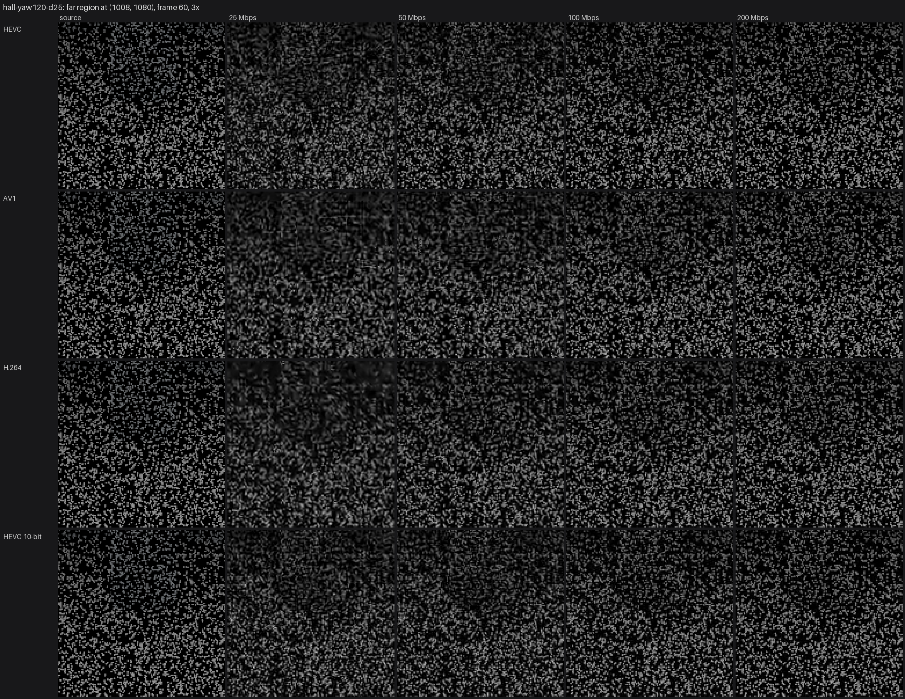

# How the dots survive the video stream (codec simulator, 2026-10-20)

The headset never sees the game's frames: SteamVR encodes them as video (NVENC on the RTX 4080) and the Frame
decodes them. Small bright dots on black are close to the worst content for that. This report ranks dot
styles by how they come through, measured offline with the same NVENC hardware, before anyone puts the
headset on (plan §6.3). It ranks options; it doesn't predict exactly what the Frame will show (see *Limits*).

## The answer

**Make the minimum dot size 3 px (now 2.5).** Keep the Ash palette and the 2.5 cm dedup cell. If SteamVR
lets you choose, stream HEVC, 8-bit.

- **2.5 px holds up only while the head is still.** Once the head moves at all (even standing still the way
  people do), the encoder runs at its cap. At 50 Mbps per eye, one dot in ten then shows at under 75% of its
  brightness on a slow turn, and under 61% on a fast one. Beyond 4 m, where every dot is at the minimum
  size, it's worse (p10 0.69–0.78). Dots flicker by about 10% of their brightness from frame to frame.
- **3 px is the knee.** At the same 50 Mbps, p10 is 0.98 on a slow turn and 0.89 on a fast one, and flicker
  drops to 8%. Even at 25 Mbps on a slow turn only 0.2% of dots fall under half brightness (2.5 px: 3.4%).
- **3.5 px survives almost perfectly, but the far field turns into grey blotches.** p10 is 0.98–1.03 from
  50 Mbps up in every motion (0.83 at 25 Mbps on a fast turn). But beyond about 8 m the dots touch and merge
  (crops below). A 4 cm dedup cell keeps 3.5 px dots apart where surfaces are scanned densely (the floor a
  few metres ahead), but not in the far field: there, density comes from how many rays reached the surface,
  not from the cell.
- **1.5 px doesn't survive motion.** On a slow turn at 25 Mbps, 38% of dots end up under half brightness,
  and beyond 16 m the median dot keeps 10% of its brightness. Even at 200 Mbps per eye it's only as good as
  2.5 px at 100.
- **The palette barely matters to the codec.** Mono against Ash: p10 +0 to +0.03. Ash's faint tints cost
  nothing measurable in brightness. (Chroma wasn't measured; see *Limits*.)
- **A 4 cm dedup cell** helps 2.5 px a little (p10 +0.01 to +0.07, with 37% fewer dots) but is no
  substitute for size.
- **Codec:** HEVC came out best in motion. AV1 and H.264 trail it, AV1 usually a little ahead. **HEVC 10-bit
  doesn't help:** it's no better on slow motion and much worse on fast turns at 50 Mbps (p10 0.32 against
  0.61), at least with NVENC's low-latency mode. AV1 is the best of all when the image is still.
- **Scanning itself is cheap.** With the head still, dots growing in where the scanner points survive at
  p10 0.97 at 25 Mbps, and the encoder needs only 15–26 Mbps for it.

What to check on the Frame: the README's first-run checklist already asks for Min dot 1.5 / 2.5 / 3.5. The
simulator says 3 is the one to try first. The wrist menu doesn't offer 3 yet; adding it is a small follow-up.

## What was simulated

- **Scene:** the hall, eye at (0, 1.6, −16) looking north, columns from 2 to 15 m, far wall at 18 m. It was
  filled by 2 M seeded random rays cast from a 2 m box around the eye, as if you'd stood there and scanned
  all round: 791 k dots with the 2.5 cm cell, 501 k with 4 cm. The same rays every time, so styles compare
  like for like. A second view from the terrace over the expanse covers the far field.
- **Frames:** one eye at 2160×2160, 100° FOV, 4× MSAA, sRGB as the headset gets it (`renderPixels` in
  `src/dev/snapshot.ts`). 90 frames at 90 fps of virtual time, so motion is exact whatever the browser does.
- **Motions:** *still* (frozen: the ideal); *sway* (standing still the way people do: ±1.2° of drift, up to
  2.6°/s, a few mm of body sway); *yaw30* and *yaw120* (a turn at 30°/s and 120°/s); *walk* (1.4 m/s
  forward); *scan* (head still, the scanner sweeping 28° across a patch the fill left unscanned, 1,100 rays
  per frame, dots growing in).
- **Encoding:** NVENC (`h264_nvenc`, `hevc_nvenc`, `av1_nvenc`), low-latency CBR (preset p4, tune ull, no
  B-frames, one IDR then P-frames, a two-frame buffer), 8-bit 4:2:0, plus HEVC Main10. BT.709 limited range.
  25 / 50 / 100 / 200 Mbps **per eye**. The plan expects 100–400 Mbps for both eyes, so 50–200 per eye.
- **Measured** after the first 15 frames (the I-frame and rate control settling):
  - **Dot survival:** about 1,900 dots (more in the scan), spread over 5 distance bands, are tracked through every frame
    (`dots.json`: where each one lands, its size, its expected brightness). Each dot's peak luma after
    decoding is divided by its peak before. The tables give the **10th percentile (p10)** (the dimmest tenth
    of dots end up below this) and the share **lost** (under half). Above 1 means codec overshoot: ringing
    makes dot centres a little brighter.
  - **Dot flicker:** the frame-to-frame change of each dot's coding error, relative to its brightness. A
    steadily coded dot scores 0.
  - **Shimmer, SSIM, PSNR** over the whole frame and over the 512² crop with the most dot texture. They're in
    `docs/codec/tables.md`. SSIM and PSNR mislead here: they score 3.5 px *worse* than 2.5 px (more
    bright pixels means more absolute error), while the dots themselves come through far better.

## Numbers (HEVC, per eye; cells are p10 · lost)

**A slow turn (30°/s), by bitrate:**

| Style | 25 Mbps | 50 Mbps | 100 Mbps | 200 Mbps |
|---|---|---|---|---|
| 1.5 px | 0.07 · 37.9% | 0.44 · 12.1% | 0.67 · 3.1% | 0.84 · 0.3% |
| 2.5 px (current default) | 0.62 · 3.4% | 0.75 · 0.6% | 0.84 · 0.0% | 0.91 · 0.0% |
| **3 px** | **0.92 · 0.2%** | **0.98 · 0.0%** | **1.01 · 0.0%** | **1.01 · 0.0%** |
| 3.5 px | 1.00 · 0.1% | 1.02 · 0.0% | 1.03 · 0.0% | 1.03 · 0.0% |
| 2.5 px, 4 cm cell | 0.67 · 1.7% | 0.78 · 0.1% | 0.87 · 0.0% | 0.92 · 0.0% |
| 3.5 px, 4 cm cell | 1.00 · 0.0% | 1.02 · 0.0% | 1.03 · 0.0% | 1.02 · 0.0% |
| 2.5 px, Mono palette | 0.65 · 2.2% | 0.76 · 0.2% | 0.85 · 0.0% | 0.91 · 0.0% |

**By motion at 50 Mbps (p10 · lost · dot flicker):**

| Style | still | sway | yaw30 | yaw120 | walk |
|---|---|---|---|---|---|
| 1.5 px | 0.96 · 0.0% · 0% | 0.56 · 7.0% · 18% | 0.44 · 12.1% · 19% | 0.04 · 42.6% · 21% | 0.47 · 11.4% · 19% |
| 2.5 px | 0.97 · 0.0% · 0% | 0.79 · 0.1% · 10% | 0.75 · 0.6% · 10% | 0.61 · 4.2% · 10% | 0.74 · 0.5% · 10% |
| **3 px** | – | **0.99 · 0.0% · 8%** | **0.98 · 0.0% · 8%** | **0.89 · 0.4% · 8%** | – |
| 3.5 px | 1.00 · 0.0% · 0% | 1.02 · 0.0% · 7% | 1.02 · 0.0% · 7% | 0.98 · 0.1% · 7% | 1.01 · 0.0% · 7% |
| 2.5 px, 4 cm cell | 0.97 · 0.0% · 0% | 0.81 · 0.0% · 9% | 0.78 · 0.1% · 10% | 0.68 · 2.0% · 10% | 0.77 · 0.1% · 10% |

**By distance, slow turn, 50 Mbps (median / p10).** Near dots are bigger than the minimum and survive; past
about 4 m every dot is at the minimum size, and that's where the size matters:

| Style | 0–2 m | 2–4 m | 4–8 m | 8–16 m | 16 m+ |
|---|---|---|---|---|---|
| 1.5 px | 1.14 / 1.08 | 1.10 / 0.92 | 0.87 / 0.58 | 0.78 / 0.35 | 0.76 / 0.19 |
| 2.5 px | 1.16 / 1.08 | 1.11 / 0.95 | 0.96 / 0.78 | 0.92 / 0.70 | 0.94 / 0.69 |
| 3 px | 1.13 / 1.08 | 1.12 / 1.00 | 1.13 / 0.99 | 1.12 / 0.95 | 1.13 / 0.97 |
| 3.5 px | 1.14 / 1.08 | 1.13 / 1.03 | 1.13 / 1.03 | 1.14 / 1.02 | 1.11 / 1.00 |

**Codecs, 2.5 px, fast turn (120°/s):**

| Codec | 25 Mbps | 50 Mbps | 100 Mbps | 200 Mbps |
|---|---|---|---|---|
| HEVC | 0.26 · 23.6% | 0.61 · 4.2% | 0.78 · 0.3% | 0.88 · 0.0% |
| AV1 | 0.22 · 28.0% | 0.46 · 12.2% | 0.68 · 2.0% | 0.86 · 0.1% |
| H.264 | 0.19 · 37.1% | 0.50 · 9.9% | 0.66 · 2.1% | 0.81 · 0.1% |
| HEVC 10-bit | 0.17 · 33.2% | 0.32 · 17.9% | 0.70 · 2.4% | 0.85 · 0.1% |

**Head still vs moving.** With the head frozen, HEVC settles at 17–22 Mbps whatever the cap (AV1 24–31) and
is near-lossless (p10 0.94–0.98). Any motion, even the gentle sway, puts it at the cap (HEVC used 188 Mbps
of 200). The terrace (fewer dots in view, mostly a floor) does better than the hall: p10 0.80 at 25 Mbps on a
slow turn against 0.62. Everything else, per codec, capture and band, is in `docs/codec/tables.md` and
`tables_full.md`.

## Crops

Frame 60 of the slow turn, 144×144 eye pixels enlarged 3× with nearest-neighbour, source then 25 / 50 / 100 /
200 Mbps HEVC. One row per style; the same region of the same view in each.

The far field (8 m+). 1.5 px dots break up into blocks at 25 Mbps. 2.5 px dims and smears in patches at 25
and 50. 3 px stays crisp. 3.5 px (with either cell) merges into grey toward the top:



The densest region (the floor a few metres ahead):



Codecs at 2.5 px on a fast turn (120°/s), far region:



## Limits

- **SteamVR's encoder settings are unknown:** the codec, the bitrate, foveated encoding, slices and
  intra-refresh. The rate control here is one plausible low-latency setup. Ask what SteamVR shows (plan
  §6.5), then re-run at the real bitrate.
- **One eye**, no lens distortion, no foveation, no reprojection. Real frames are both eyes, and the encoder
  splits its bits between them.
- **Luma only.** The metrics are on brightness, which is where this game keeps its information. 4:2:0
  colour loss isn't measured; the crops show it (tints fade).
- **The fill is one kind of scan:** random rays from one spot. A player who aims at things builds a
  different density. The scan capture shows one focused sweep.
- **The 3 px row has sway, yaw30 and yaw120 only** (no still or walk), as does the 3.5 px / 4 cm row; the
  Mono row has sway and yaw30.

## Re-running it

```bash
npm run dev
```

Then open `http://localhost:5180/?capture=hall-yaw30-d30&motion=yaw30&minpx=3` (about 50 s; frames go to
`.captures/hall-yaw30-d30/`), or run several from the console in one page:
`await __capture.run({ name, motion, minPx, palette, cell, view })`. Then:

```bash
python tools/codec/codec.py all hall-yaw30-d30
```

That does 16 encodes and the measurements and crops (about 2.5 min). Then
`python tools/codec/codec.py report <captures…> --region-from <capture>` writes the tables and style
sheets. Each capture is about 400 MB of PNGs plus encodes; this run left 19 GB in `.captures/` (git-ignored,
safe to delete).
